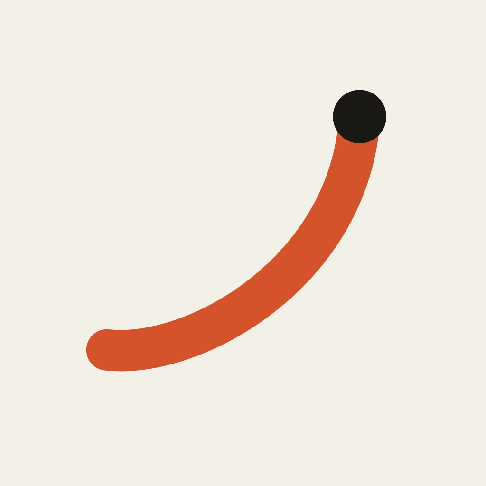
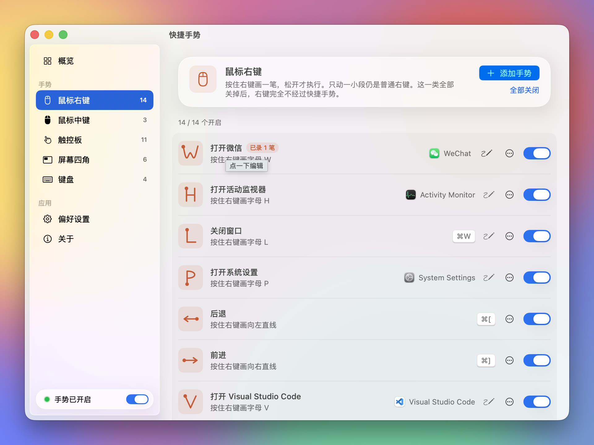

<p align="center">
  
</p>

<h1 align="center">GesturePad (快捷手势)</h1>

<p align="center">
  Hold, draw, release.<br>
  A macOS menu bar app for mouse, trackpad and hot-corner gestures that open apps, send shortcuts and arrange windows.
</p>

<p align="center">
  <a href="https://github.com/itsdangding/GesturePad/actions/workflows/ci.yml"></a>
  
  
  <a href="LICENSE"></a>
</p>

<p align="center">
  <a href="README.md">简体中文</a> · English · <a href="https://itsdangding.github.io/GesturePad/">Website</a> · <a href="https://itsdangding.github.io/GesturePad/gestures.html">All gestures</a>
</p>

<p align="center">
  
</p>

> The app UI is in Simplified Chinese for now. Translations are welcome, see [CONTRIBUTING.md](CONTRIBUTING.md).

## What it does

| Input | Examples |
| --- | --- |
| **Right mouse button**: hold and draw a line or letter, release to run | W opens WeChat, ← goes back, ↗ maximizes the window |
| **Middle button**: draw, or hold it and turn the wheel | S locks the screen, the wheel switches tabs |
| **Trackpad**: hold Fn, then draw with one finger | → snaps the window right; Fn + tap a corner snaps it to a quarter |
| **Screen corners**: push the pointer into a corner, then right-click or turn the mouse wheel | Top-left right-click starts the screensaver; bottom-right wheel changes the volume |
| **Keyboard**: global hotkeys | ⌥ + arrows snap windows to halves |

- **Stays out of the way.** A short right-click is still a right-click. The trackpad is a normal trackpad unless Fn is held. Two-finger clicks on the trackpad go straight to the system.
- **Your own gestures.** Switch off, edit, delete or add any gesture. Triggers: a line or letter, a trackpad corner, holding a button while scrolling, a screen corner, or a hotkey. Actions: open an app, URL or folder, send a shortcut, arrange the window, lock the screen, start the screensaver, change brightness or volume. You get a warning when two gestures share a trigger.
- **Record your handwriting.** If a letter isn't recognized well, record how you draw it.
- **Separate scroll directions.** Pick system, standard or natural scrolling for the mouse wheel and the trackpad independently. macOS only has one switch for both.
- **Liquid Glass.** The settings window uses Liquid Glass on macOS 26 and frosted material on macOS 14 and 15, in light and dark mode.
- **Offline.** Settings and recorded strokes stay on your Mac.

The defaults reflect the author's habits (WeChat, VS Code). Apps you don't have are marked "未安装" (not installed). Change or delete them.

## Install

Requires macOS 14+ and the Xcode command line tools (`xcode-select --install`).

```sh
git clone https://github.com/itsdangding/GesturePad.git
cd GesturePad
./scripts/install.sh
```

The script runs the tests, builds, signs and installs to `~/Applications/快捷手势.app`, then opens it. To update, `git pull` and run the script again.

Once versions are tagged, prebuilt zips appear on the [Releases](https://github.com/itsdangding/GesturePad/releases) page. They are not notarized, so run `xattr -dr com.apple.quarantine ~/Applications/快捷手势.app` before the first launch.

Permissions: **Accessibility** (required: listens to the mouse, posts shortcuts, moves windows) and **Input Monitoring** (optional: keyboard hotkeys only).

### Uninstall

```sh
killall GesturePad
rm -rf ~/Applications/快捷手势.app "$HOME/Library/Application Support/GesturePad"
defaults delete com.ddang.gesturepad
```

Then remove 快捷手势 from Accessibility and Input Monitoring in System Settings → Privacy & Security.

## FAQ

**Why does the context menu appear only on release?** On mouse down the app can't tell a gesture from a click yet. Trackpad two-finger clicks are not affected. If you don't use right-button gestures, switch that whole group off and right-clicks bypass the app entirely.

**Gestures stopped working after a rebuild?** Ad hoc signatures change with every build, so macOS treats it as a new app. Remove and re-add it under Accessibility, or sign with an Apple Development or Developer ID certificate.

**What did it just do?** Actions are written to the system log:

```sh
log show --last 10m --predicate 'process == "GesturePad"'
```

## Develop

```sh
swift build
swift test
GESTUREPAD_PREVIEW=mouse swift run   # settings window only, no event tap, no writes
python3 scripts/build-docs.py        # regenerate the website after changing defaults
```

Preview extras: `GESTUREPAD_PREVIEW_BACKDROP=1` (colorful backdrop for the glass), `GESTUREPAD_PREVIEW_DARK=1`, `GESTUREPAD_PREVIEW_TRAIL=1` (sample stroke on screen), `GESTUREPAD_PREVIEW_UNTRUSTED=1`.

`GesturePadCore` holds the stroke recognizer (a $1-style unistroke matcher with shape features), the rule model and the scroll logic. It has no UI dependencies and is covered by unit tests. The app target holds the event tap, the trackpad reader (private `MultitouchSupport` framework), the action runner and the SwiftUI settings window.

## License

[MIT](LICENSE) © 2026 Dang Ding
