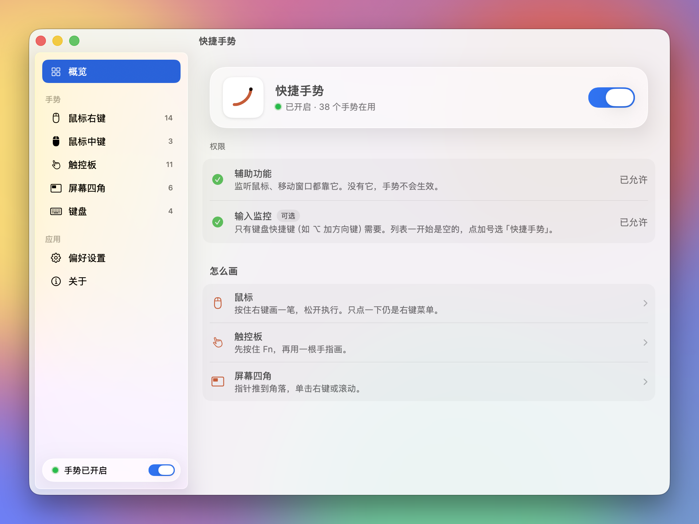
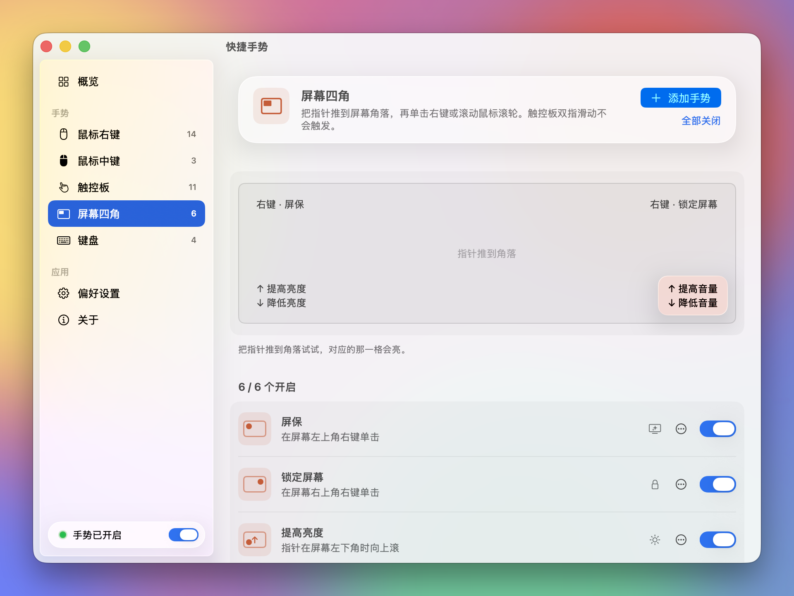

<p align="center">
  
</p>

<h1 align="center">快捷手势 GesturePad</h1>

<p align="center">
  按住，画一笔，松手。<br>
  macOS 菜单栏里的手势工具：用鼠标、触控板和屏幕四角打开应用、发快捷键、摆放窗口。
</p>

<p align="center">
  <a href="https://github.com/itsdangding/GesturePad/actions/workflows/ci.yml"></a>
  
  
  <a href="LICENSE"></a>
</p>

<p align="center">
  简体中文 · <a href="README.en.md">English</a> · <a href="https://itsdangding.github.io/GesturePad/">介绍页</a> · <a href="docs/gestures.html">全部手势</a>
</p>

<p align="center">
  
</p>

## 能做什么

| 画法 | 例子 |
| --- | --- |
| **鼠标右键** 按住右键画直线或字母，松开执行 | 画 W 打开微信，向左一划后退，向右上最大化窗口 |
| **鼠标中键** 按住中键画，或按住中键滚动 | 画 S 锁屏，按住中键滚动切换标签 |
| **触控板** 先按住 Fn 再用一根手指画 | 画 → 窗口靠右半屏；按住 Fn 轻点四角，窗口缩到四分之一 |
| **屏幕四角** 指针推到角落，右键单击或滚动鼠标滚轮 | 左上角右键开屏保；右下角滚动调音量 |
| **键盘** 全局快捷键 | ⌥ 加方向键把窗口放到半屏 |

- 短按右键仍然是右键菜单，触控板不按 Fn 就是普通光标，平常操作不会误触。
- 字母认不准时，在设置里点那一行的笔形按钮，照你的写法画一次。
- 每一条手势都能开关、修改、删除，也能添加自己的：选画法或快捷键，再选打开应用、网址、文件夹，发快捷键，摆放窗口等动作。
- 没装的应用会标出「未安装」。
- 不联网。设置和录下的笔迹只存在本机。

完整列表见 [全部手势](docs/gestures.html)。

## 安装

需要 macOS 14 及以上和 Xcode 命令行工具（`xcode-select --install`）。

```sh
git clone https://github.com/itsdangding/GesturePad.git
cd GesturePad
./scripts/install.sh
```

脚本会跑测试、编译，装到 `~/Applications/快捷手势.app` 并打开。本机有 Apple Development 证书时用它签名，没有就临时签名。

也可以在 [Releases](https://github.com/itsdangding/GesturePad/releases) 下载打包好的 zip。它没有经过 Apple 公证，第一次打开前需要去掉隔离标记：

```sh
xattr -dr com.apple.quarantine ~/Applications/快捷手势.app
```

### 权限

| 权限 | 用途 | 必需 |
| --- | --- | --- |
| 辅助功能 | 监听鼠标、发快捷键、移动窗口 | 是 |
| 输入监控 | 键盘快捷键（如 ⌥ 加方向键） | 否 |

第一次打开会弹出设置窗口，照提示授权即可。程序不在 `/Applications` 时，系统设置的列表里可能看不到它：点加号，用访达前往 `~/Applications/快捷手势.app`。

> 临时签名的版本每次重新编译后签名都会变，系统可能要你重新授权辅助功能。用 Apple Development 证书签名可以避免。

## 设置窗口

<p align="center">
  
  
</p>

- **概览**：总开关、权限状态、三种画法的说明。
- **手势**：按鼠标右键、中键、触控板、屏幕四角、键盘分类。可以添加、编辑、删除、开关，字母可以录下自己的写法。
- **偏好设置**：鼠标滚轮和触控板分开设滚动方向、轨迹显示、Fn 要求、登录时启动、恢复默认。

菜单栏只有四行，每行都有图标：当前状态、打开设置、暂停或继续、退出。暂停时菜单栏图标会变灰。

## 隐私

快捷手势不联网，不收集任何数据。手势设置和录下的笔迹存在 `~/Library/Application Support/GesturePad/rules.json`。触发记录只写进系统日志，不写文件。

## 开发

```sh
swift build          # 编译
swift test           # 跑识别器和规则的单元测试
GESTUREPAD_PREVIEW=mouse swift run   # 只打开设置窗口，不监听事件，方便调界面
```

`GESTUREPAD_PREVIEW` 可以是 `overview`、`mouse`、`middle`、`trackpad`、`corner`、`key`、`preferences`、`about`。这个模式只在调试版里有。加上 `GESTUREPAD_PREVIEW_BACKDROP=1` 会在窗口后面垫一张彩色背景，方便看磨砂玻璃效果；`GESTUREPAD_PREVIEW_DARK=1` 强制深色外观。

```
Sources/
  GesturePadCore/      与界面无关，可测试
    StrokeRecognizer   直线和字母识别（$1 单笔识别 + 形状特征）
    Rules              手势、动作、默认规则、规则文件读写
  GesturePad/          macOS 应用
    EventController    CGEventTap：右键、中键、滚轮、键盘
    TrackpadMonitor    内置触控板单指轨迹（私有 MultitouchSupport）
    ActionRunner       打开应用、发快捷键、摆放窗口、媒体键
    Overlay            屏幕上的笔迹
    Settings/          SwiftUI 设置窗口
Tests/GesturePadCoreTests
docs/                  介绍页（GitHub Pages）
scripts/               打包、安装、生成图标
```

触控板用的是系统私有框架 `MultitouchSupport`。找不到它时触控板手势会关掉，其余功能照常。

## 参与

欢迎提问题、提建议、发 PR。开始前请看 [贡献指南](CONTRIBUTING.md)。

## 许可

[MIT](LICENSE) © 2026 Dang Ding
