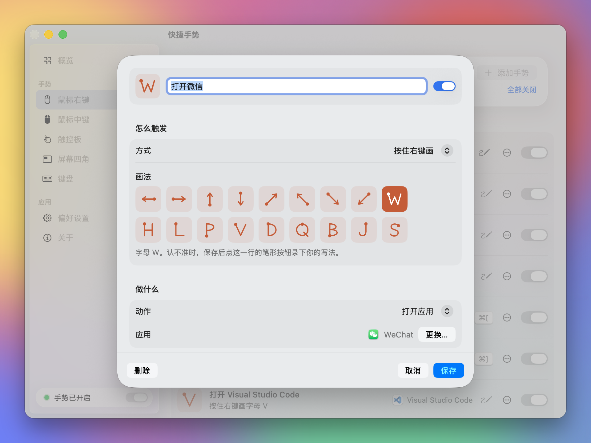

<p align="center">
  
</p>

<h1 align="center">快捷手势 GesturePad</h1>

<p align="center">
  按住，画一笔，松手。<br>
  macOS 菜单栏里的手势工具：用鼠标、触控板和屏幕四角打开应用、发快捷键、摆放窗口。
</p>

<p align="center">
  <a href="https://github.com/itsdangding/GesturePad/actions/workflows/ci.yml"></a>
  
  
  <a href="LICENSE"></a>
</p>

<p align="center">
  简体中文 · <a href="README.en.md">English</a> · <a href="https://itsdangding.github.io/GesturePad/">介绍页</a> · <a href="https://itsdangding.github.io/GesturePad/gestures.html">全部手势</a>
</p>

<p align="center">
  
</p>

## 能做什么

| 画法 | 例子 |
| --- | --- |
| **鼠标右键**：按住右键画直线或字母，松开执行 | 画 W 打开微信，向左一划后退，向右上最大化窗口 |
| **鼠标中键**：按住中键画，或按住中键滚动滚轮 | 画 S 锁屏，按住中键滚动切换标签 |
| **触控板**：先按住 Fn，再用一根手指画 | 画 → 窗口靠右半屏；按住 Fn 轻点四角，窗口缩到四分之一 |
| **屏幕四角**：指针推到角落，单击右键或滚动鼠标滚轮 | 左上角右键开屏保；右下角滚动调音量 |
| **键盘**：全局快捷键 | ⌥ 加方向键把窗口放到半屏 |

- **不打扰平常操作**：短按右键仍是右键菜单；触控板不按 Fn 就是普通光标；触控板双指点按的右键直接交给系统，不经过快捷手势。
- **手势可以自己定**：每一条都能开关、修改、删除，也能新建。触发方式可以是画直线或字母、触控板四角、按住按键滚动、屏幕角落或键盘快捷键；动作可以是打开应用、网址、文件夹，发快捷键，摆放窗口，锁屏、屏保、亮度、音量。触发方式和别的手势重复时会提醒。
- **字母认不准就录一笔**：点那一行的笔形按钮，照你的写法画一次，之后按你的笔迹来认。
- **滚动方向分开设**：鼠标滚轮和触控板各自选「跟随系统」「传统」或「自然」，不再被系统一个开关同时管住。
- **液态玻璃外观**：macOS 26 上设置窗口是液态玻璃；macOS 14 和 15 自动换成普通磨砂，深色模式都支持。
- **不联网**：设置和录下的笔迹只存在本机。

默认手势见 [全部手势](https://itsdangding.github.io/GesturePad/gestures.html)。其中「打开微信」「打开 Visual Studio Code」这类是作者的习惯，没装的应用会标出「未安装」，可以直接改成你常用的或删掉。

## 安装

需要 macOS 14 及以上和 Xcode 命令行工具（`xcode-select --install`）。

```sh
git clone https://github.com/itsdangding/GesturePad.git
cd GesturePad
./scripts/install.sh
```

脚本会跑测试、编译、签名，装到 `~/Applications/快捷手势.app` 并打开。本机有 Apple Development 证书时用它签名，没有就临时签名。以后更新：`git pull` 之后再跑一次 `./scripts/install.sh`。

发布版本后，[Releases](https://github.com/itsdangding/GesturePad/releases) 页面会有打包好的 zip。它没有经过 Apple 公证，第一次打开前需要去掉隔离标记：

```sh
xattr -dr com.apple.quarantine ~/Applications/快捷手势.app
```

### 权限

| 权限 | 用途 | 必需 |
| --- | --- | --- |
| 辅助功能 | 监听鼠标、发快捷键、移动窗口 | 是 |
| 输入监控 | 键盘快捷键（如 ⌥ 加方向键） | 否 |

第一次打开会弹出设置窗口，照提示授权即可。程序不在 `/Applications` 时，系统设置的列表里可能看不到它：点加号，用访达前往 `~/Applications/快捷手势.app`。

### 卸载

```sh
killall GesturePad
rm -rf ~/Applications/快捷手势.app "$HOME/Library/Application Support/GesturePad"
defaults delete com.ddang.gesturepad
```

再到「系统设置 → 隐私与安全性」的「辅助功能」和「输入监控」里删掉「快捷手势」。

## 设置窗口

<p align="center">
  
  
</p>

- **概览**：总开关、权限状态、三种画法的说明。
- **手势**：按鼠标右键、中键、触控板、屏幕四角、键盘分类。点一行就能编辑；行尾的「…」菜单里可以录笔迹或删除。
- **偏好设置**：滚动方向、画出轨迹、触控板是否必须按住 Fn、登录时启动、恢复默认手势。

菜单栏图标点开只有四行，每行都有图标：当前状态、打开设置（⌘,）、暂停或继续手势、退出（⌘Q）。暂停时菜单栏图标会变灰。

## 常见问题

**为什么右键菜单要松手才出来？**
按下右键时还不知道你是要画手势还是普通右键，要等松手才能判断。触控板双指点按不受影响。不用鼠标右键手势的话，在「鼠标右键」那一页点「全部关闭」，右键就完全不经过快捷手势。

**重新编译后手势不灵了？**
临时签名的版本每次编译签名都会变，系统会把它当成新程序。到「辅助功能」里把「快捷手势」删掉再重新加上。用 Apple Development 或 Developer ID 证书签名就不会这样。

**触控板手势没反应？**
只认内置触控板，外接妙控板暂不支持。确认画的时候按住了 Fn，偏好设置里的触控板状态显示「内置触控板可用」。

**怎么看触发了什么？**
记录写在系统日志里：

```sh
log show --last 10m --predicate 'process == "GesturePad"'
```

## 隐私

快捷手势不联网，不收集任何数据。手势设置和录下的笔迹存在 `~/Library/Application Support/GesturePad/rules.json`。触发记录只写进系统日志。

## 开发

```sh
swift build                          # 编译
swift test                           # 识别器、规则、滚动的单元测试
GESTUREPAD_PREVIEW=mouse swift run   # 只打开设置窗口，不监听事件，方便调界面
python3 scripts/build-docs.py        # 改了默认手势后，重新生成介绍页
```

预览模式只在调试版里有，不会写规则文件，可以和装好的那一份同时运行。`GESTUREPAD_PREVIEW` 可以是 `overview`、`mouse`、`middle`、`trackpad`、`corner`、`key`、`preferences`、`about`。还可以加上：

| 环境变量 | 作用 |
| --- | --- |
| `GESTUREPAD_PREVIEW_BACKDROP=1` | 窗口后面垫一张彩色背景，看磨砂玻璃效果 |
| `GESTUREPAD_PREVIEW_DARK=1` | 强制深色外观 |
| `GESTUREPAD_PREVIEW_TRAIL=1` | 在屏幕上画一笔示例笔迹 |
| `GESTUREPAD_PREVIEW_UNTRUSTED=1` | 模拟还没授权的状态 |

```
Sources/
  GesturePadCore/        与界面无关，有单元测试
    StrokeRecognizer     直线和字母识别（$1 单笔识别 + 形状特征）
    Rules                手势、动作、默认规则、规则文件读写
    Scrolling            滚动来源判断和方向翻转
  GesturePad/            macOS 应用
    EventController      CGEventTap：右键、中键、滚轮、键盘
    TrackpadMonitor      内置触控板的手指轨迹（私有 MultitouchSupport）
    ActionRunner         打开应用、发快捷键、摆放窗口、媒体键
    Overlay              屏幕上的笔迹
    Settings/            SwiftUI 设置窗口、手势编辑器、液态玻璃样式
Tests/GesturePadCoreTests
docs/                    介绍页（GitHub Pages），由 scripts/build-docs.py 生成
scripts/                 安装、打包、生成介绍页和图标
```

触控板用的是系统私有框架 `MultitouchSupport`。找不到它时触控板手势会关掉，其余功能照常。

## 参与

欢迎提问题、提建议、发 PR。开始前请看 [贡献指南](CONTRIBUTING.md)，改动记在 [更新记录](CHANGELOG.md) 里。

## 许可

[MIT](LICENSE) © 2026 Dang Ding
